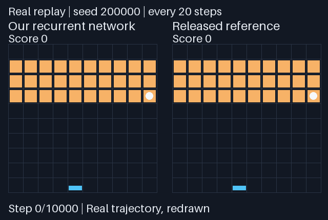

# 不训练，直接构造一个打砖块神经网络

**Weight-written Breakout**：一个与 AI 协作完成的学习实验。从游戏规则出发，直接设置神经网络的结构和权重，让它在 MinAtar 打砖块环境中运行。

本仓库保留三版实现、权重、逐局结果和复现方法，供大家参考。欢迎通过 [Issue](https://github.com/guangxiangdebizi/weight-written-breakout/issues) 或 PR 指出问题、提供复现结果、讨论更好的方案。

## “没有训练”具体指什么

- 没有梯度下降、反向传播、强化学习训练，也没有用游戏样本拟合权重。
- 权重由规则推导、几何计算和有限时域动态规划直接构造。
- **使用了开发测试反馈**：观察失败、修改规则、比较候选，再冻结模型做独立测试。因此不属于零反馈、一次生成。
- 推理时只有固定神经网络计算及内部记忆更新，不调用大模型，也不在网络外执行动态规划。

动态规划仍然是在优化动作选择；大模型推理、权重构造和评测也有计算成本。“没有训练”不表示没有计算或优化。

## 起点与实验过程

起点是 MIT CSAIL 研究者的研究博客 [Sparks of Weight-Space Programming](https://rikiyat.github.io/blog/weight-space-programming/)。其中实验 5 让大模型直接写出 MinAtar 小网络的权重。这个学习实验进一步尝试：自行设计网络，把策略直接写进权重，再通过开发集迭代。

| 阶段 | 主要设计 | 当轮独立测试均分 | 当轮对照 |
| --- | --- | ---: | ---: |
| [V1](experiments/v1) | 球/轨迹检测，预测侧墙反弹后的落点 | 16.539 | 简单追球 8.366 |
| [V2](experiments/v2) | 读取砖块布局，球上升时提前预测 | 255.997 | V1 同种子重测 17.959 |
| [V3](experiments/v3) | 增加短期记忆，将抗重复动作策略编译进权重 | 672.681 | 原研究公开模型同种子重测 512.860 |

**各阶段用了不同的测试种子，表中只应直接比较同一行。** 完整的修改理由、未选中的候选和种子划分见 [实验过程](docs/experiment-process.md)。

本实验由人提出方向与迭代要求，AI 助手完成了主要网络构造、代码实现、实验执行和文档整理。仓库记录的是实际运行结果，不代表项目发起者独立编写或独立推导了所有内容。

## 最终比较：相同游戏协议，不同网络规模

下载并保留[原研究公开 checkpoint](https://github.com/RikiyaT/lm_understand-logs/tree/4d09ba6d6a7e891dd8063974dfe81b3d78e3494f/exp5_write_from_scratch)。先复跑确认结果与报告相容，再与冻结的 V3 在同一组新种子上比较。

共同设置：MinAtar **1.0.15**；相同 600 维对象通道编码；从 softmax 采样动作；重复上一动作的概率为 **0.1**；每局最多 **10,000 步**；各 **1,000 局**；种子 **200000–200999**。

| 指标 | V3 | 原研究公开权重 |
| --- | ---: | ---: |
| 平均得分 | 672.681 | 512.860 |
| 均值的 95% bootstrap 区间 | 658.322–687.535 | 497.943–527.695 |
| 中位数 | 764.0 | 647.5 |
| 达到步数上限的局数 | 784 | 517 |

V3 的均分高 **31.16%**。配对平均差为 **159.821 分**，95% bootstrap 区间为 **142.271–178.183 分**。每块砖计 1 分；触及步数上限的回合按累计得分计入，没有删除。

**规模与开发条件不同：**

| 项目 | V3 | 原研究公开模型 |
| --- | --- | --- |
| 网络 | 循环 ReLU 网络 | 两层隐藏层 tanh MLP |
| 稠密参数位置 | 5,393,916 | 20,486 |
| 非零权重及偏置 | 48,202 | 815 |
| 内部记忆 | 12 维 | 无 |
| 构造过程 | 多轮开发反馈 | 一次生成、无环境反馈 |

结果说明这个更大、经过迭代的专用网络，在所列协议下得分更高。它不支持同规模、同开发预算的优势结论，也不说明通用大模型可以免训练构造。

把重复动作概率提高到 **0.25** 后，各测 200 局：V3 为 **163.990** 分，公开模型为 **75.005** 分。两者都明显退化。统计量与原始 CSV 见 [完整结果](experiments/v3/comparison.json)。

### 看一段真实轨迹



这张动图根据真实评测轨迹重绘，不是原生游戏截图。它固定取测试集第一局 `seed=200000`，每隔 20 步抽一帧，没有挑最佳局。该局 V3 为 793 分、达到 10,000 步上限；公开模型为 289 分、在第 4,278 步结束。单局成绩不是上表的均分。

## 快速复现

已验证环境：Python **3.13**。建议使用独立虚拟环境。

```bash
git clone https://github.com/guangxiangdebizi/weight-written-breakout.git
cd weight-written-breakout
python -m venv .venv
```

激活环境：Windows PowerShell 使用 `.venv\Scripts\Activate.ps1`；Linux/macOS 使用 `source .venv/bin/activate`。

```bash
python -m pip install -r requirements.txt
python -m unittest discover -s tests -v
python experiments/v3/verify.py --model experiments/v3/recurrent-0.01.npz --reference experiments/v3/reference-hand.npz
```

运行完整的 1,000 局对照：

```bash
python experiments/v3/benchmark.py --model experiments/v3/recurrent-0.01.npz --kind compiled_fast --plan experiments/v3/protocol.json --split heldout --output work/rerun-ours
python experiments/v3/benchmark.py --model experiments/v3/reference-hand.npz --kind reference --plan experiments/v3/protocol.json --split heldout --output work/rerun-reference
```

输出目录必须不存在，防止覆盖结果。`compiled_fast` 是位并行加速的神经电路计算；换成 `compiled` 可使用通用稀疏矩阵/ReLU 后端。

从规则重建权重，不需要游戏轨迹：

```bash
python experiments/v3/build_weights.py --output work/rebuilt
```

其他版本的运行方法见 [复现说明](docs/reproduce.md)。

## 网络怎样工作

V3 的计算链为：

```text
600 维观察 + 12 维内部记忆
    → 轨迹与碰撞条件检测
    → 接球时间、可接位置、上一步移动方向
    → 固定控制表对应的神经元
    → 6 个动作 logits + 下一步 12 维记忆
```

权重构造阶段，用已知游戏转移规则计算控制表，再编译成稀疏 ReLU 连接。运行阶段不重新求解控制表。详细公式、记忆更新和实现限制见 [机制说明](docs/how-it-works.md)。

## 仓库内容

- `experiments/v1/`：第一版代码、权重和完整结果。
- `experiments/v2/`：第二轮六个候选及独立测试。
- `experiments/v3/`：循环网络、三个候选、公开基线及最终对照。
- `docs/`：实验过程、机制和复现方法。
- `tests/`：权重重建、哈希、统计量和数据完整性检查。
- `scripts/render_replay.py`：从真实轨迹重建示例动图。

## 欢迎交流

这是一个学习和参考实现。欢迎指出错误，也欢迎提供不同实现或复现结果。尤其希望讨论：

1. 能否在保持效果的同时，大幅减少神经元和非零连接？
2. 在相同网络规模、记忆和开发预算下，直接构造权重能做到什么程度？
3. 不依赖完整游戏源码时，这种构造方式还能适用于哪些任务？

提交反馈时附上版本、种子、运行命令和结果，方便一起定位。详见 [参与方式](CONTRIBUTING.md)。

## 许可与来源

自有代码、构造的权重和自行生成的实验结果采用 [MIT License](LICENSE)。
第三方 `reference-hand.npz` 保留 **CC BY 4.0**，作者、来源和哈希见 [署名说明](experiments/v3/ATTRIBUTION.txt)；MinAtar 是独立安装的 **GPL-3.0** 依赖，不打包进本仓库。原研究公开权重没有被修改，也没有用于初始化我们的模型。

许可范围另见 [第三方声明](THIRD_PARTY_NOTICES.md)。

- [原研究博客](https://rikiyat.github.io/blog/weight-space-programming/)
- [原研究日志与 checkpoint](https://github.com/RikiyaT/lm_understand-logs)
- [MinAtar 官方仓库](https://github.com/kenjyoung/MinAtar)
